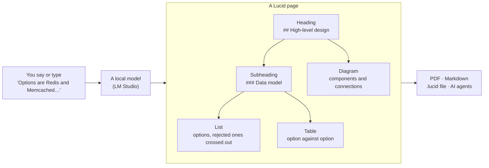
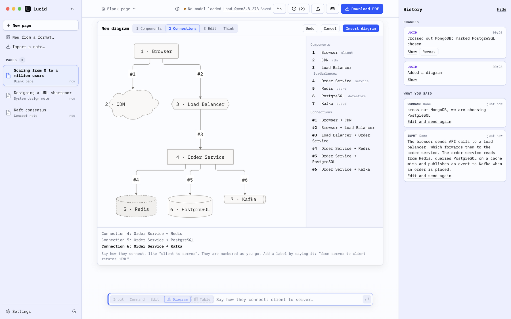
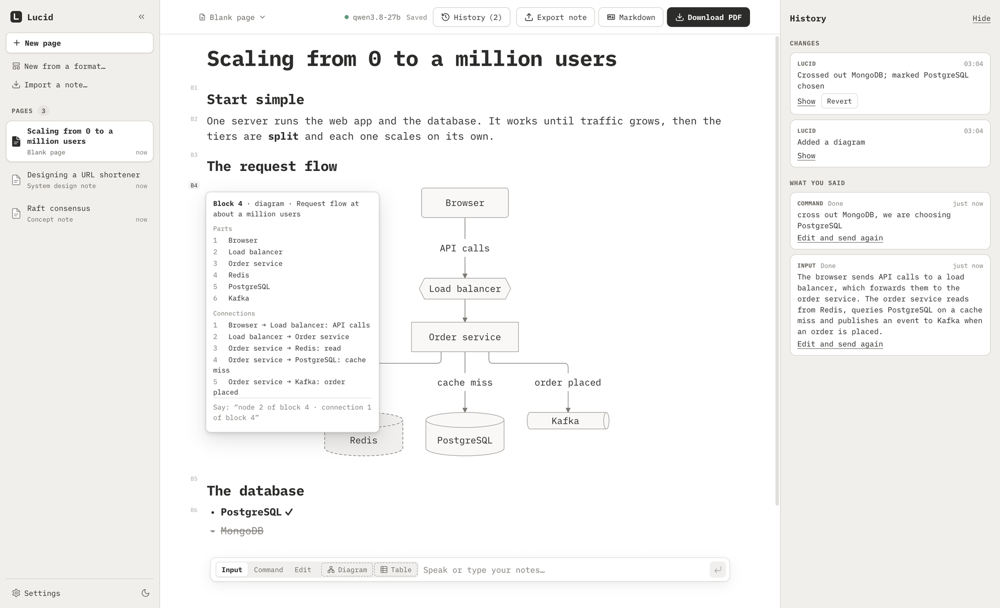
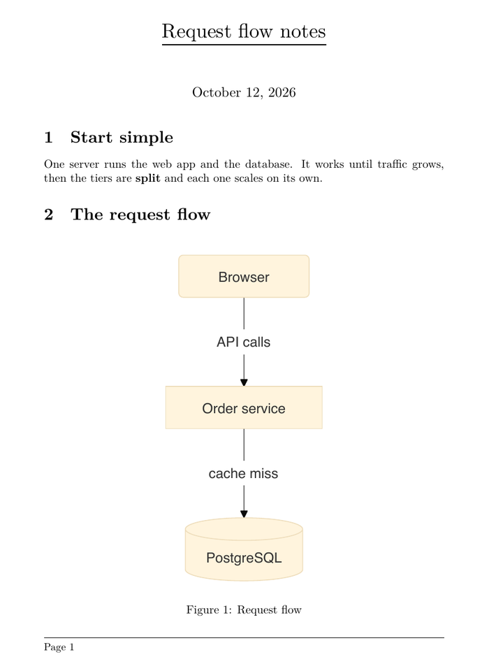

<p align="center">
  
</p>

<h1 align="center">Lucid</h1>

<p align="center">
  <b>A structured document, built while you think.</b><br />
  Say or type your thoughts. Lucid arranges them as headings, lists, tables and diagrams, and typesets them.<br />
  A local-first note editor: the language model runs on your own Mac.
</p>

<p align="center">
  <a href="https://github.com/triggeredcode/lucid/releases/latest"></a>
  <a href="LICENSE"></a>
  
  <a href="https://github.com/triggeredcode/lucid/actions/workflows/ci.yml"></a>
</p>

<p align="center">
  <a href="https://triggeredcode.github.io/lucid/"><b>Website</b></a> ·
  <a href="https://github.com/triggeredcode/lucid/releases/latest"><b>Download</b></a> ·
  <a href="docs/guide.html">User guide</a> ·
  <a href="CHANGELOG.md">Changelog</a>
</p>

<p align="center">
  <picture>
    <source media="(prefers-color-scheme: dark)" srcset="docs/images/lucid-dark.png" />
    
  </picture>
</p>

## The idea

Engineers think in structure. A system design is an outline of sections and sub-sections, a list of options with the rejected
ones crossed out, a table that compares them and a diagram of how the parts connect. Lucid builds exactly that document while
you think out loud, so you never stop to format. It was made for system-design notes, and it is open to any subject that
fits the same shapes: the [note formats](#made-for-system-design-open-to-other-fields) are plain data you can change or extend.



Everything on a page is a **typed block**. The model only chooses which block fits what you said and fills it in; Lucid draws
and typesets it, so the result looks the same every time.

| Block | What it holds | How it is drawn |
|---|---|---|
| **Heading, subheading** | the outline: title, sections, sub-sections | numbered sections in the PDF |
| **List** | options, steps, trade-offs; bullets, numbered steps and checklists, each item on its own so one can be crossed out | bullets, struck-through when rejected |
| **Table** | a comparison: properties by options | a typeset table |
| **Diagram** | how parts connect: architecture, request flow, sequence, entities | drawn from components and connections, a database as a cylinder, a queue as a pipe |
| **Callout** | the key takeaway, a decision, a trade-off, a warning, an open question | a highlighted box |
| **Formula** | back-of-the-envelope maths (KV-cache size, FLOPs, bandwidth) | typeset LaTeX maths |
| **Chart** | numbers you dictated: bars or lines | a labelled chart |
| **Code** | an API request, a query, a shell command | a code listing |

What stays true whatever you say:

- **The model never writes LaTeX or drawing code.** It fills blocks; a fixed house style does the typography.
- **You stay in charge.** Every change by the model is exactly one undo step, any earlier change can be reverted on its own,
  and your words are never lost: if the model cannot use them, they are kept as written.
- **One view.** The page, one input box under it, an optional history panel. It scales to a full-screen window.
- **Voice or keyboard.** Dictate with [Wispr Flow](https://wisprflow.ai) (optional) or just type. Lucid takes the text from
  there.
- **A toolbox for AI agents.** An MCP server lets Claude Code, or a model in LM Studio's chat, read and edit the same blocks.

## Install

Lucid is a macOS app for **Apple Silicon**, **macOS 13 or newer**.

1. Download `Lucid-<version>-arm64.dmg` from the [latest release](https://github.com/triggeredcode/lucid/releases/latest),
   open it and drag **Lucid** to **Applications**.
2. Open Lucid. macOS will say it cannot check the app for malicious software, because Lucid is a free open-source app that is
   not notarized by Apple. Allow it once:
   - **macOS 15 and newer:** close the message, open **System Settings → Privacy & Security**, scroll down to the message
     about Lucid and click **Open Anyway**.
   - **macOS 13 and 14:** right-click Lucid in Applications, choose **Open**, then **Open** again.
   - Or in Terminal: `xattr -dr com.apple.quarantine /Applications/Lucid.app`
3. Install [LM Studio](https://lmstudio.ai), download the model **`qwen/qwen3.8-27b`**, and start its local server
   (Developer tab). Lucid's pill at the top says what is missing and can load the model for you.

Each release lists SHA-256 checksums (`SHA256SUMS`), so you can check the download with `shasum -a 256 --ignore-missing -c SHA256SUMS`. The
source is here; you can [build the app yourself](#build-from-source).

**Good to know**

- Nothing else needs installing: the PDF engine ([Tectonic](https://tectonic-typesetting.github.io)) and the diagram
  drawing come with the app.
- **The first PDF needs the internet, once.** Tectonic downloads its typesetting files the first time it runs (several hundred
  small ones, about five minutes). Lucid does it in the background after the first start and shows the progress next to
  *Download PDF*. After that PDFs take a second or two and work offline.
- Lucid is evaluated with `qwen/qwen3.8-27b` only. Another model can be named in Settings, but expect more misses. A 27B
  model needs a lot of memory; Lucid was developed on a Mac with 48 GB.

## Quick start

1. Click **New page**, or **New from a format…** to start from one of five note formats.
2. Type or dictate notes in the box at the bottom: *"A cache hit costs microseconds, a miss costs a database round trip.
   Options are Redis, Memcached and a local LRU."* They appear on the page, structured, a few seconds later.
3. Switch to **Command** (⌘2) and talk about the page: *"Cross out Memcached, we are choosing the local LRU."*
   *"Add a row for cost to this table."*
4. **Download PDF** when it looks right. **Edit** (⌘3) is there for the few things the model gets wrong.

The full walkthrough is the user guide: **Help → Lucid Guide** in the app, or [`docs/guide.html`](docs/guide.html).

## What it does

### Three modes, one box

| Mode | Your words are | Switch |
|---|---|---|
| **Input** | notes, written into the page and structured | ⌘1 |
| **Command** | instructions about the page: "add a CDN in front of the web server", "undo" | ⌘2, or hold the right ⌥ key for one command |
| **Edit** | typing in the page itself | ⌘3 |

⌘4 opens the diagram builder and ⌘5 the table builder. Changes that would throw something away wait for a yes; when Lucid
is unsure which thing you mean, it asks.

### Diagrams and tables by voice

A diagram of ten parts is hard to say in one breath, so there is a guided builder: say the **components**, then the
**connections** ("client to server"), then fix them **by number** ("rename 3 to Cache", "reverse 2"). A database is drawn as a
cylinder, a queue as a pipe, a CDN as a cloud, a load balancer as a hexagon. Big diagrams stay readable in the page and in the
PDF.

<p align="center">
  
</p>

### Say which block you mean

Every block has a light number in the margin (B1, B2, …). Click one to see its parts, then say *"in block 3, add a row for
cost"* or *"cross out item 2 of block 6"*. The numbers can be hidden in Settings.

<p align="center">
  
</p>

### History you can trust

The panel on the right lists what you said and every change to the page: by Lucid, by a builder, by an AI agent, or a revert.
**Show** scrolls to what a change touched. **Revert** takes back *one earlier* change, not just the last, and leaves later
changes to other blocks alone.

### Export

Dictation is placed under the section it belongs to ("the options are Kafka and SQS" goes under *Options*). Export as:

- **PDF**, typeset with Tectonic in a fixed house style (numbered sections, real tables and figures, formulas);
- **Markdown** (diagrams as Mermaid blocks);
- **A `.lucid` file**, the whole note with its history, to back up, move to another Mac or share.

<p align="center">
  
</p>

Light and dark themes, three typefaces, and a zoom for the page (⌘+, ⌘−, ⌘0) are in the app. Pages are plain files in
`~/Lucid` (one JSON file per page).

## Made for system design, open to other fields

A **note format** is the skeleton of a page: its sections, a hint for each saying what belongs there, and which blocks suit it.
Start a page from one with **New from a format…**; Lucid suggests one from what you say, and you always choose.

| Format | For | Sections |
|---|---|---|
| **Concept note** | one computer-science or system-design idea | Definition · Intuition · How it works · Example · Pitfalls and gotchas · Related concepts |
| **System design** | designing a system end to end | Requirements · Capacity estimates · API · High-level design · Data model · Deep dives · Trade-offs and decisions · Open questions |
| **Comparison** | choosing between technologies | Context · Options · Comparison · Pros and cons · Decision |
| **Inference engineering** | KV cache, FLOPs, bandwidth, batching | Intuition · The math · Numbers to remember · Hardware implications · Pitfalls |
| **Benchmark** | recording an experiment | Goal and hypothesis · Setup · Method · Results · Observations · Next experiments |

The formats lean towards engineering because that is what Lucid was made for, but nothing else in Lucid does. A format is a
small data entry in [`packages/kit/src/formats/index.ts`](packages/kit/src/formats/index.ts): an id, a description, keywords
for the suggestion, the sections and the blocks that suit them. A lab notebook, a reading log or a study plan is one more
entry. New block types (one folder each) work the same way. See [`CONTRIBUTING.md`](CONTRIBUTING.md).

## For AI agents

Lucid is also an MCP server. With the app running, Claude Code can read and edit your pages:

```bash
claude mcp add lucid -e ELECTRON_RUN_AS_NODE=1 -- /Applications/Lucid.app/Contents/MacOS/Lucid /Applications/Lucid.app/Contents/Resources/lucid-mcp.mjs
```

Every agent change is one undo step and appears in the history as the agent's. The tools, the LM Studio set-up and what can go
wrong are in [`docs/mcp.md`](docs/mcp.md).

## Privacy

Lucid has no account, no analytics and no cloud service. Your notes are files on your disk, and the language model runs in
LM Studio on your computer. The only time Lucid's own PDF engine uses the internet is the one-time download of typesetting
files described above. If you dictate with Wispr Flow, that is a separate app with its own privacy terms; Lucid only sees the
text it pastes.

## Build from source

You need macOS on Apple Silicon, Node 22.12 or newer, and [pnpm](https://pnpm.io) 9.

```bash
git clone https://github.com/triggeredcode/lucid.git
cd lucid
pnpm install
node scripts/fetch-tectonic.mjs   # the PDF engine, checked against a pinned SHA-256
pnpm dev
```

| Command | |
|---|---|
| `pnpm test` | unit tests (all packages) |
| `pnpm e2e` | Electron end-to-end tests with a fake LM Studio, in a maximized window |
| `pnpm run ci` | typecheck, lint, formatting and unit tests |
| `pnpm eval` | 74 cases (and their variants) against the real model in LM Studio; see [`docs/evals.md`](docs/evals.md) |
| `pnpm dist` | builds `apps/desktop/release/Lucid-<version>-arm64.dmg` and `.zip` |
| `pnpm e2e:packaged` | runs the end-to-end tests against the built app (after `pnpm dist:dir`) |

The repository is a pnpm workspace:

| | |
|---|---|
| `packages/core` | pure TypeScript: the document model, the op language, the guided builders, persistence. No DOM, no network. |
| `packages/kit` | the block kit: block types, note formats, Markdown and LaTeX output, diagram layout |
| `packages/llm` | the LM Studio client and the prompts |
| `packages/mcp` | the MCP server for agents |
| `packages/evals` | the eval cases and runner |
| `packages/mock-lmstudio` | a scripted LM Studio for tests |
| `apps/desktop` | the Electron app (React and [BlockNote](https://www.blocknotejs.org)) |

Unit, integration and end-to-end tests never need LM Studio: they use the scripted server. More in
[`CONTRIBUTING.md`](CONTRIBUTING.md) and [`docs/architecture.md`](docs/architecture.md).

## Troubleshooting

| You see | Do |
|---|---|
| *LM Studio isn't running* | Start LM Studio and its local server, then click **Check again**. |
| *No model loaded* | Click **Load …** in the pill, or `lms load qwen/qwen3.8-27b --context-length 32768 --parallel 1 -y`. |
| A request takes 10 to 25 seconds | Normal for a 27B model on a laptop; the first request after a change is the slowest. |
| *Getting the PDF engine ready…* | Normal on the first start: wait, it counts the files. A PDF you ask for meanwhile waits for it. |
| Words were kept as *unprocessed* | The model could not use them; they are kept as written. Say them again, or fix them in Edit mode. |
| Dictation does nothing | Is Lucid the focused window? A paste goes to the input box wherever the focus is in the window. |

More in the guide. Something else? [Open an issue](https://github.com/triggeredcode/lucid/issues/new/choose).

## Contributing and security

Issues and pull requests are welcome; read [`CONTRIBUTING.md`](CONTRIBUTING.md) first. Report security problems privately, as
described in [`SECURITY.md`](SECURITY.md). Changes are listed in [`CHANGELOG.md`](CHANGELOG.md).

## Licence

[MIT](LICENSE). Lucid is built on open-source software; see [`THIRD_PARTY_NOTICES.md`](THIRD_PARTY_NOTICES.md). Special thanks
to [BlockNote](https://www.blocknotejs.org), [Mermaid](https://mermaid.js.org), [Tectonic](https://tectonic-typesetting.github.io),
[Electron](https://www.electronjs.org) and [iA Writer Mono](https://github.com/iaolo/iA-Fonts).
