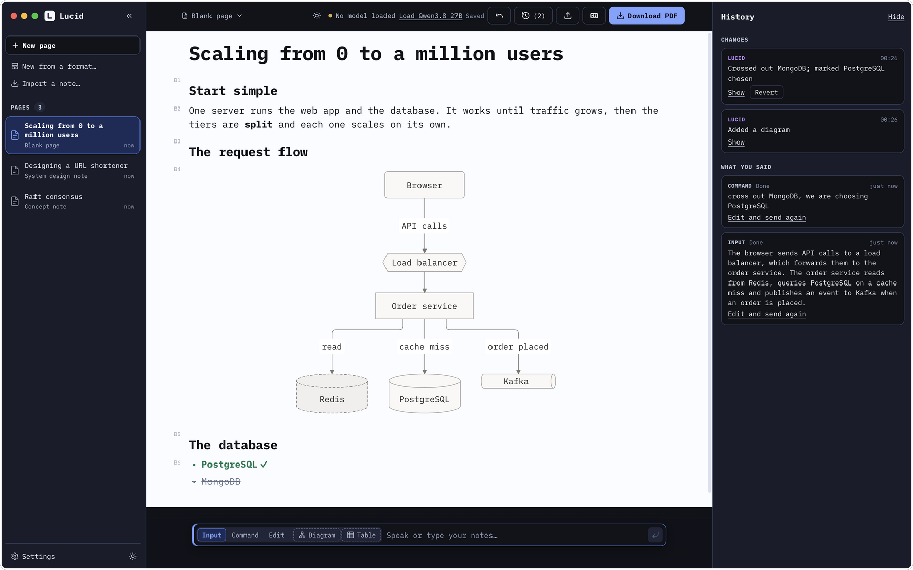
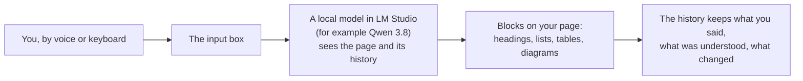
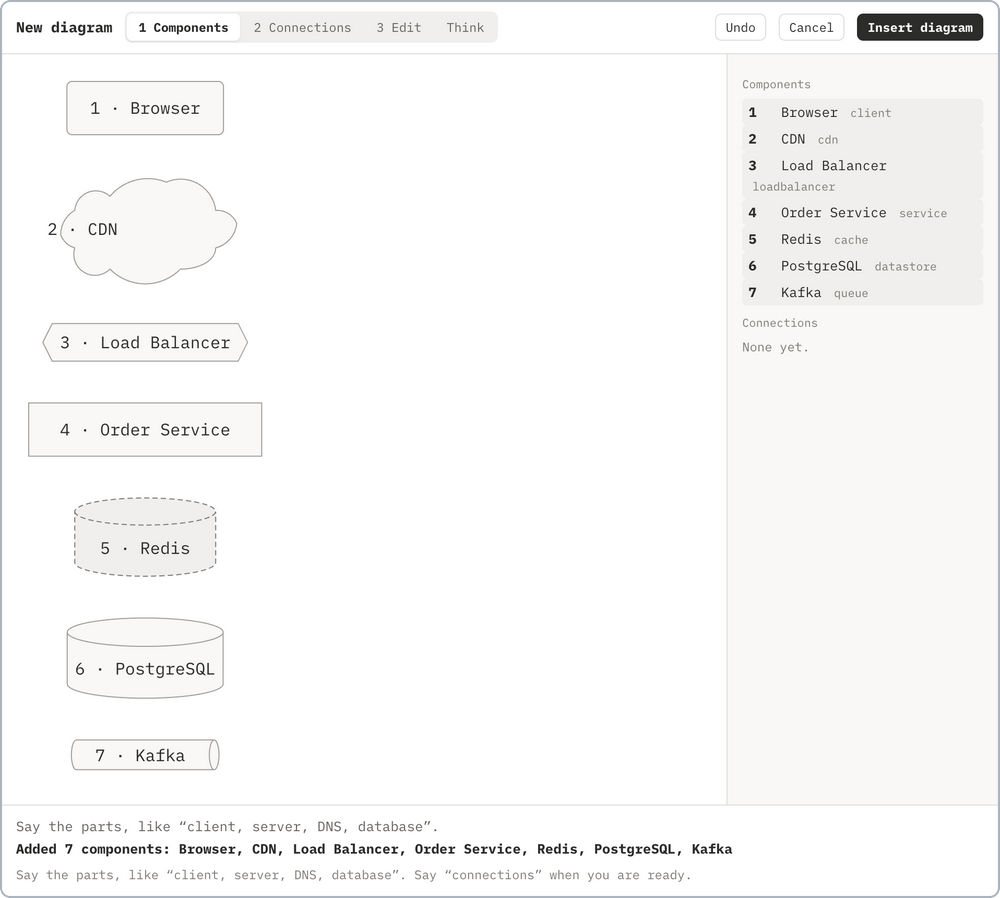
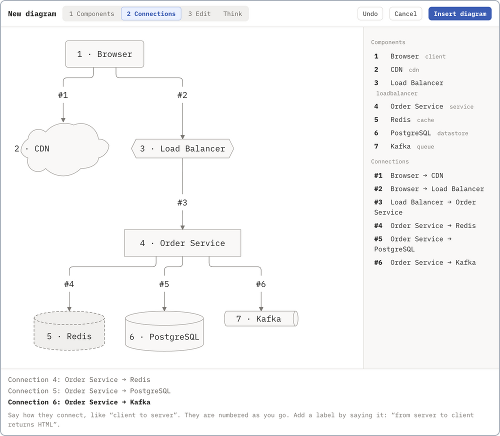
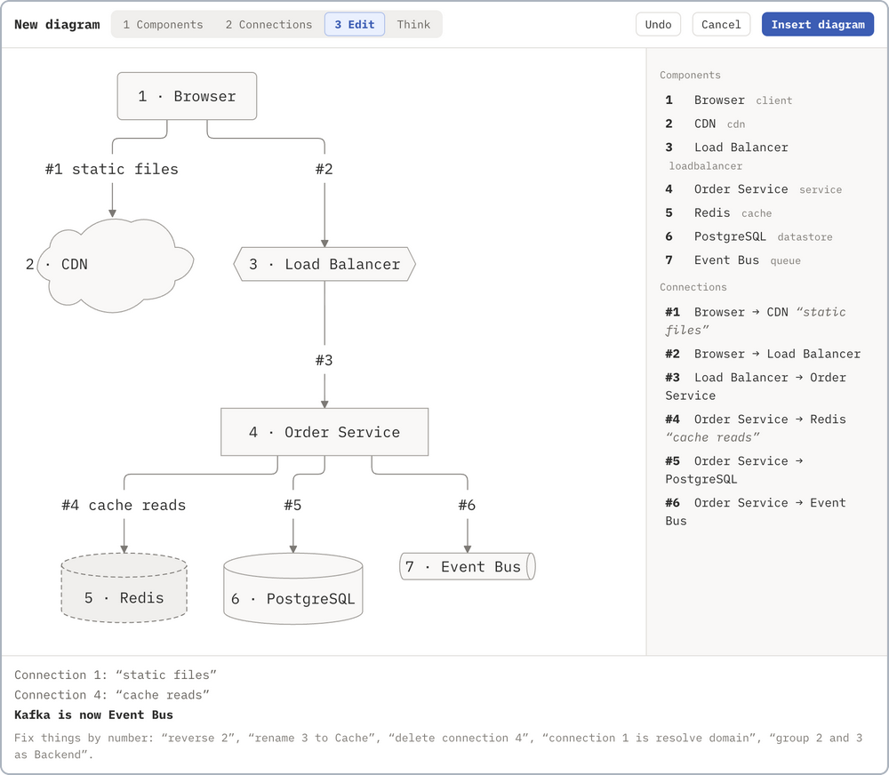
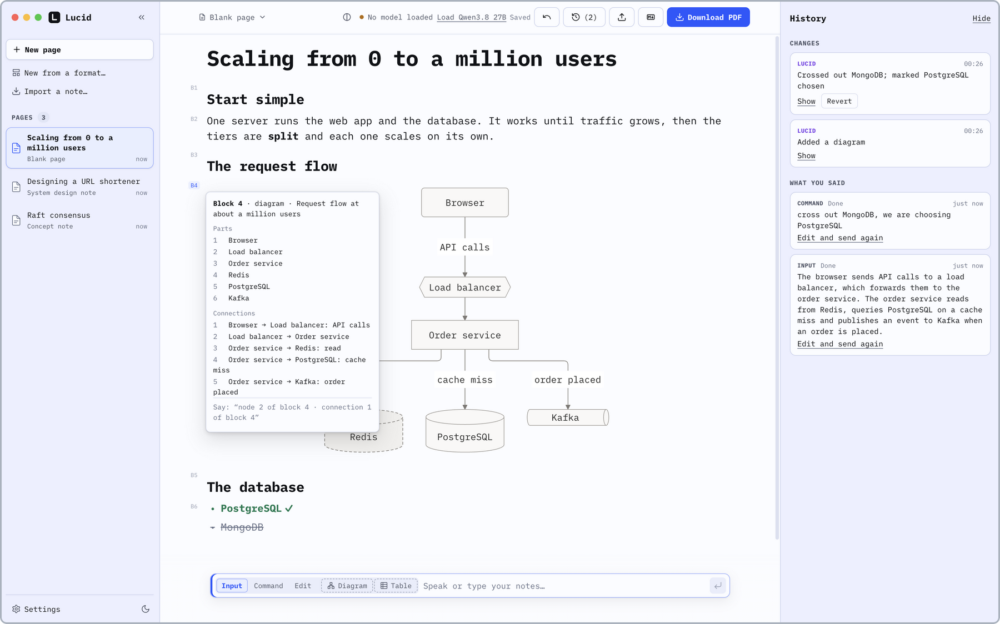
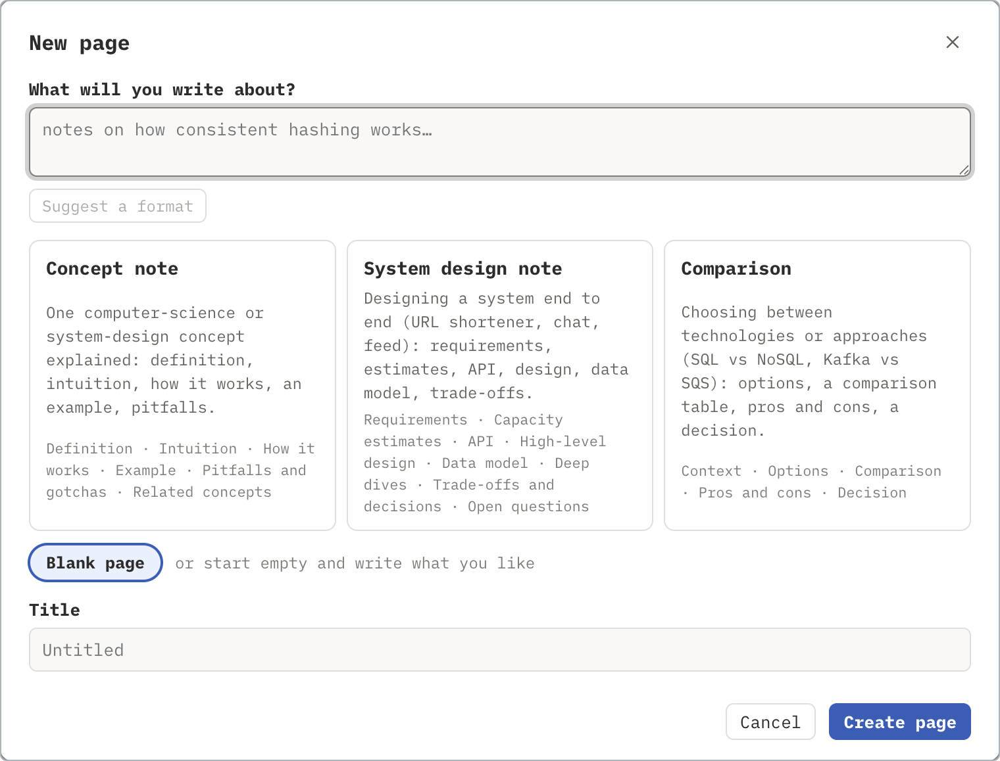
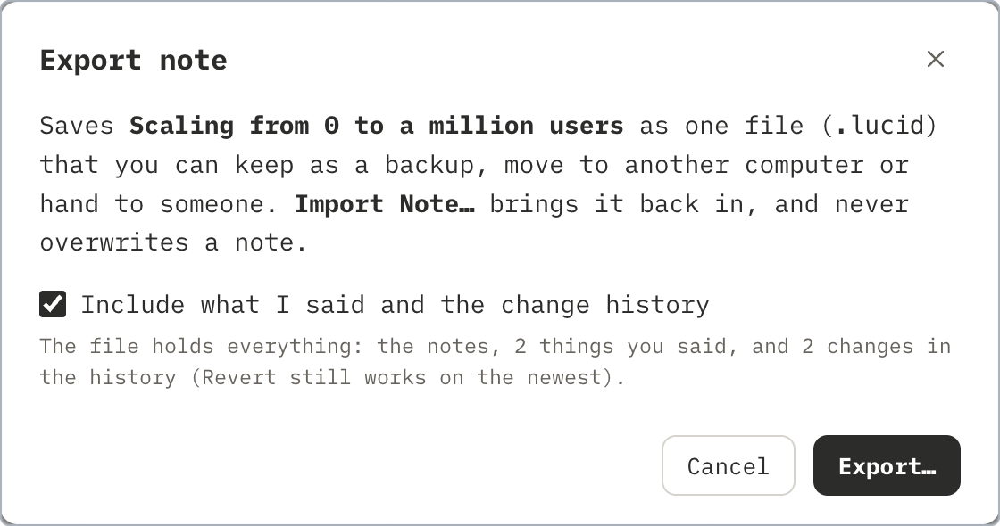
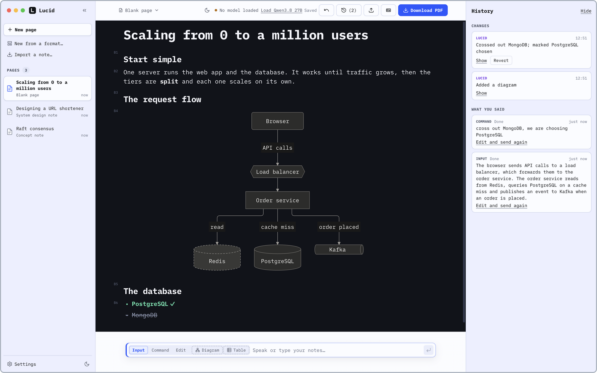

<p align="center">
  
</p>

<h1 align="center">Lucid</h1>

<p align="center">
  <b>Voice to structured notes and diagrams.</b><br />
  Talk, and Lucid builds the headings, lists, tables and diagrams while you think, then typesets a PDF.<br />
  Made to work hands-free or one-handed, and local-first: the language model runs on your own computer.
</p>

<p align="center">
  <a href="https://github.com/triggeredcode/lucid/releases/latest"></a>
  <a href="LICENSE"></a>
  
  <a href="https://github.com/triggeredcode/lucid/actions/workflows/ci.yml"></a>
</p>

<p align="center">
  <a href="https://triggeredcode.github.io/lucid/"><b>Website</b></a> ·
  <a href="https://github.com/triggeredcode/lucid/releases/latest"><b>Download</b></a> ·
  <a href="docs/guide.html">User guide</a> ·
  <a href="CHANGELOG.md">Changelog</a>
</p>

<p align="center">
  
</p>

## Why I made it

For a while I couldn't type comfortably, so I built Lucid for myself: a productivity and accessibility tool for taking notes and
learning system design by voice, or with one hand.

I learn by thinking out loud, and I want to see it as I say it: the diagram when I explain a system, the notes taking shape when I
revise, and a way to cut what I got wrong and say it again. There are good open-source tools that turn voice into text, and others
that draw diagrams, but I couldn't find one project where I could simply speak and get something *structured*, entirely on my own
computer. I like minimal themes, so I built the one I wanted, for myself first.

This is the first version, and it doesn't listen by itself. You dictate with an app that pastes text, like
[Wispr Flow](https://wisprflow.ai), [OpenWhispr](https://github.com/OpenWhispr/openwhispr) or
[VoiceNative](https://github.com/triggeredcode/voicenative) (my own open-source voice-to-text for macOS), and Lucid turns what
lands in the box into the page. A fully local voice pipeline will take me some time to get right; you can start with those.

## How it works



The model runs on your computer and never leaves it. It always has the page in front of it, so it does not only add text: it
puts what you said under the right heading and builds the right kind of block. Every change is exactly one undo step, and your
words are never lost.

## The two parts I like most

### Diagram mode: keywords, connections, editing

A diagram of ten parts is hard to say in one breath, so there is a guided builder with three phases. First the **keywords**: say
the parts of the system. Then the **connections**: say how they connect, one at a time. Then **editing**: everything has a number,
so a fix is one short sentence (*"connection 3 is reads and writes"*, *"rename 3 to Cache"*). Say *"done"* and the diagram goes
onto your page. A database is drawn as a cylinder, a queue as a pipe, a CDN as a cloud, a load balancer as a hexagon.

<table>
  <tr>
    <td width="33%" align="center">
      <picture>
        <source media="(prefers-color-scheme: dark)" srcset="docs/images/readme/builder-keywords-dark.png" />
        
      </picture>
      <br /><sub><b>1. Keywords</b></sub>
    </td>
    <td width="33%" align="center">
      <picture>
        <source media="(prefers-color-scheme: dark)" srcset="docs/images/readme/builder-connections-dark.png" />
        
      </picture>
      <br /><sub><b>2. Connections</b></sub>
    </td>
    <td width="33%" align="center">
      <picture>
        <source media="(prefers-color-scheme: dark)" srcset="docs/images/readme/builder-edit-dark.png" />
        
      </picture>
      <br /><sub><b>3. Editing</b></sub>
    </td>
  </tr>
</table>

### Command mode: talk to the page

Because the model has the whole page in context, you can talk about it and it edits the page for you: *"add a cache in front of
the database"*, *"cross out Memcached, we are choosing the local LRU"*, *"add a row for cost to this table"*, *"undo"*. Crossing
out keeps the idea on the page, struck through, so you can still see what you decided against. Hold the right ⌥ key and
everything you say is one command, which you can do with one hand.

## History, edit mode and how well it works

The history keeps what you said, what the model understood and what it changed, so you can always see why a page looks the way
it does, take back any single change (not just the last one), or edit what you said and send it again. When the model gets
something wrong there is **Edit mode**: you just type in the page.

<p align="center">
  <picture>
    <source media="(prefers-color-scheme: dark)" srcset="docs/images/readme/block-numbers-dark.png" />
    
  </picture>
</p>

I test the model against my own set of cases with the real model ([docs/evals.md](docs/evals.md)) and hold it to a bar of 90%.
In my latest run it got 98 of 99 cases right. To get the most from it: say things in short pieces, use diagram mode for diagrams
and command mode to change the page, and look at the history whenever something surprises you.

## Keep your notes

- **PDF**, typeset on your computer, with real diagrams. Settings → **PDF look** sets the paper, the type, the margins and an
  accent colour, and you can edit the template itself.
- **A whole note**, with its history, to back up or move to another computer, and **Markdown**.
- **Three note formats** to start from (a concept note, a system design, a comparison) or a blank page; formats are plain data, so
  one of your own is one more entry. [See them](docs/formats.md).
- **The page has its own light and dark**, apart from the app's, so a dark app can show a light page, like paper.

<table>
  <tr>
    <td width="50%" align="center">
      <picture>
        <source media="(prefers-color-scheme: dark)" srcset="docs/images/readme/new-page-dark.png" />
        
      </picture>
      <br /><sub><b>Start from a format, or a blank page</b></sub>
    </td>
    <td width="50%" align="center">
      <picture>
        <source media="(prefers-color-scheme: dark)" srcset="docs/images/readme/export-note-dark.png" />
        
      </picture>
      <br /><sub><b>Export a whole note, with its history</b></sub>
    </td>
  </tr>
  <tr>
    <td colspan="2" align="center">
      
      <br /><sub><b>The page has a look of its own: a dark page in a light app (and, at the top of this page, a light page in a dark app)</b></sub>
    </td>
  </tr>
</table>

## Built-in MCP server

Lucid has a built-in MCP server, so an AI agent such as Claude Code can read your pages and add to them. Everything an agent does
is one undo step and shows up in the history as the agent's. The tools and the set-up are in [docs/mcp.md](docs/mcp.md).

## Where it might go

Ideas, not promises: smaller, faster local models (5B to 8B, maybe Gemma) or cloud models through Ollama for a more live mode,
models fine-tuned for notes, and other subjects than system design. Voice stays in its own project, VoiceNative, and I may
integrate the two without merging them.

## Install

| System | Download |
|---|---|
| **macOS** (Apple Silicon, macOS 13+) | `Lucid-<version>-mac-arm64.dmg` |
| **Windows** (10+, 64-bit) | `Lucid-<version>-win-x64.exe` |
| **Linux** (64-bit) | `Lucid-<version>-linux-amd64.deb` or `Lucid-<version>-linux-x86_64.AppImage` |

Get them from the [latest release](https://github.com/triggeredcode/lucid/releases/latest) or the
[website](https://triggeredcode.github.io/lucid/#download), which picks the right one for your computer. The apps are free and
not signed, so macOS and Windows ask once before opening them; the steps, the checksums and the model set-up are in
[docs/install.md](docs/install.md). You also need [LM Studio](https://lmstudio.ai) with the model `qwen/qwen3.8-27b`.

## Quick start

1. Click **New page**, or **New from a format…** to start from one of three note formats, or from a blank page.
2. Type or dictate notes in the box at the bottom: *"A cache hit costs microseconds, a miss costs a database round trip.
   Options are Redis, Memcached and a local LRU."* They appear on the page, structured, a few seconds later.
3. Switch to **Command** (⌘2) and talk about the page: *"Cross out Memcached, we are choosing the local LRU."*
4. **Download PDF** when it looks right.

To dictate, use any app that pastes text: [Wispr Flow](https://wisprflow.ai),
[OpenWhispr](https://github.com/OpenWhispr/openwhispr) (free, open source) or
[VoiceNative](https://github.com/triggeredcode/voicenative) (free, macOS). See [docs/dictation.md](docs/dictation.md).

## Learn more

| | |
|---|---|
| [User guide](docs/guide.html) | the whole app on one page (also in the app: Help → Lucid Guide) |
| [What Lucid does](docs/features.md) | typed blocks, three modes, diagrams and tables by voice, history, export and the PDF look |
| [Note formats](docs/formats.md) | the three formats, with the PDF of a sample of each |
| [Dictation](docs/dictation.md) | which apps to speak with, using Lucid by voice or with one hand, and a ten-minute check-list |
| [For AI agents](docs/mcp.md) | the MCP tools and how to connect Claude Code |
| [Installing](docs/install.md) | steps for each system, checksums, troubleshooting |
| [Architecture](docs/architecture.md) · [Evals](docs/evals.md) | how it fits together; how the model is scored |

## Contributing

Issues and pull requests are welcome. Set-up, the commands, the rules the code keeps, and how to add a note format or a block
type are in [CONTRIBUTING.md](CONTRIBUTING.md); security problems go through [SECURITY.md](SECURITY.md). Changes are listed in
the [changelog](CHANGELOG.md).

```bash
git clone https://github.com/triggeredcode/lucid.git
cd lucid
pnpm install
node scripts/fetch-tectonic.mjs   # the PDF engine, checked against a pinned SHA-256
pnpm dev
```

## Privacy

Lucid has no account, no analytics and no cloud service. Your notes are files on your disk (`~/Lucid`, one JSON file per page),
and the language model runs on your computer. The only time Lucid's own PDF engine uses the internet is the one-time download
of typesetting files. A dictation app is a separate app with its own privacy terms; Lucid only sees the text it pastes.

## Licence

[MIT](LICENSE). Lucid is built on open-source software; the list of what it bundles and their licences comes with the app
(Help, Licences of the Software Lucid Uses). Special thanks to [BlockNote](https://www.blocknotejs.org),
[Mermaid](https://mermaid.js.org), [Tectonic](https://tectonic-typesetting.github.io), [Electron](https://www.electronjs.org)
and [iA Writer Mono](https://github.com/iaolo/iA-Fonts).
