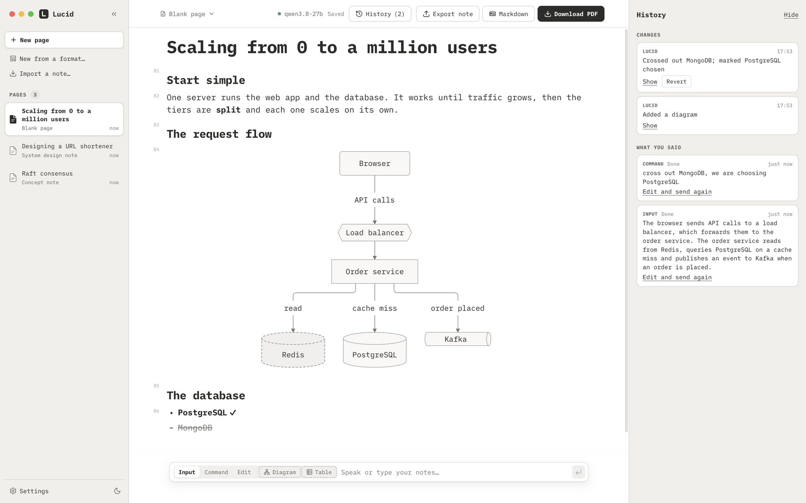

<p align="center">
  
</p>

<h1 align="center">Lucid</h1>

<p align="center">
  <b>Voice to structured notes and diagrams.</b><br />
  Talk, and Lucid builds the headings, lists, tables and diagrams while you think, then typesets a PDF.<br />
  Made to work hands-free or one-handed, and local-first: the language model runs on your own computer.
</p>

<p align="center">
  <a href="https://github.com/triggeredcode/lucid/releases/latest"></a>
  <a href="LICENSE"></a>
  
  <a href="https://github.com/triggeredcode/lucid/actions/workflows/ci.yml"></a>
</p>

<p align="center">
  <a href="https://triggeredcode.github.io/lucid/"><b>Website</b></a> ·
  <a href="https://github.com/triggeredcode/lucid/releases/latest"><b>Download</b></a> ·
  <a href="docs/guide.html">User guide</a> ·
  <a href="CHANGELOG.md">Changelog</a>
</p>

<p align="center">
  <picture>
    <source media="(prefers-color-scheme: dark)" srcset="docs/images/lucid-dark.png" />
    
  </picture>
</p>

## Why I made it

I'm the author. For a while I couldn't type comfortably. I wasn't working, but I still wanted to use the time to keep learning,
so I went back to system design and other concepts I wanted to revise. Taking notes was the hard part.

There are good open-source tools that turn voice into text, and others that draw diagrams. I couldn't find one project where I
could just speak and get something *structured*: sections, a list of options with the rejected ones crossed out, a table, a
diagram. I like minimal themes, so I built the one I wanted, for myself first.

This is the first version, and it doesn't listen by itself. You dictate with an app that pastes text, like
[Wispr Flow](https://wisprflow.ai), [OpenWhispr](https://github.com/OpenWhispr/openwhispr) or
[VoiceNative](https://github.com/triggeredcode/voicenative) (my own open-source voice-to-text for macOS), and Lucid turns what
lands in the box into the page. A fully local voice pipeline will take me some time to get right; you can start with those.

The hardest part was the drawing: a diagram engine and a table engine good enough to build from speech. Command mode edits the
page by talking to it, and the history keeps what you said, what the model understood and what it changed, so you can always see
why a page looks the way it does. The model runs on your own computer. I hold it to a bar of 90% on my own evaluation
([docs/evals.md](docs/evals.md)), and Edit mode and undo are for the rest.

Where it might go, in no particular order: a faster, more live mode with smaller local models (5B to 8B, maybe Gemma) or with
cloud models through Ollama; fine-tuned models; and fields other than system design. Voice stays in its own project,
VoiceNative, and I may integrate the two without merging them. These are ideas, not promises.

## What you get

- **Speech becomes structure, not a wall of text.** Dictation gives you the words. Lucid gives you the document: an outline of
  sections, a list of options with the rejected ones crossed out, a table that compares them, a diagram of how the parts connect.
- **By voice or by keyboard.** Notes, commands (*"cross out Memcached"*, *"add a CDN in front of the web server"*, *"undo"*),
  diagrams and tables can all be spoken. See [dictation](docs/dictation.md) for the apps and for using Lucid with one hand.
- **Made for system design, open to other fields.** The note formats are plain data: a concept note, a system design, a
  comparison, an inference-maths note, a benchmark, and one more entry for anything else. [See them](docs/formats.md).
- **You stay in charge.** Every change by the model is one undo step, any earlier change can be reverted on its own, and your
  words are never lost.
- **Local and private.** No account, no cloud service. The model runs in [LM Studio](https://lmstudio.ai) on your computer.
- **A toolbox for AI agents.** An MCP server lets Claude Code, or a model in LM Studio's chat, read and edit the same pages.

## Install

| System | Download |
|---|---|
| **macOS** (Apple Silicon, macOS 13+) | `Lucid-<version>-mac-arm64.dmg` |
| **Windows** (10+, 64-bit) | `Lucid-<version>-win-x64.exe` |
| **Linux** (64-bit) | `Lucid-<version>-linux-amd64.deb` or `Lucid-<version>-linux-x86_64.AppImage` |

Get them from the [latest release](https://github.com/triggeredcode/lucid/releases/latest) or the
[website](https://triggeredcode.github.io/lucid/#download), which picks the right one for your computer. The apps are free and
not signed, so macOS and Windows ask once before opening them; the steps, the checksums and the model set-up are in
[docs/install.md](docs/install.md). You also need [LM Studio](https://lmstudio.ai) with the model `qwen/qwen3.8-27b`.

## Quick start

1. Click **New page**, or **New from a format…** to start from one of five note formats.
2. Type or dictate notes in the box at the bottom: *"A cache hit costs microseconds, a miss costs a database round trip.
   Options are Redis, Memcached and a local LRU."* They appear on the page, structured, a few seconds later.
3. Switch to **Command** (⌘2) and talk about the page: *"Cross out Memcached, we are choosing the local LRU."*
4. **Download PDF** when it looks right.

To dictate, use any app that pastes text: [Wispr Flow](https://wisprflow.ai),
[OpenWhispr](https://github.com/OpenWhispr/openwhispr) (free, open source) or
[VoiceNative](https://github.com/triggeredcode/voicenative) (free, macOS). See [docs/dictation.md](docs/dictation.md).

## Learn more

| | |
|---|---|
| [User guide](docs/guide.html) | the whole app on one page (also in the app: Help → Lucid Guide) |
| [What Lucid does](docs/features.md) | typed blocks, three modes, diagrams and tables by voice, history, export and the PDF look |
| [Note formats](docs/formats.md) | the five formats, with the PDF of a sample of each |
| [Dictation](docs/dictation.md) | which apps to speak with, using Lucid by voice or with one hand, and a ten-minute check-list |
| [For AI agents](docs/mcp.md) | the MCP tools and how to connect Claude Code |
| [Installing](docs/install.md) | steps for each system, checksums, troubleshooting |
| [Architecture](docs/architecture.md) · [Evals](docs/evals.md) | how it fits together; how the model is scored |

## Contributing

Issues and pull requests are welcome. Set-up, the commands, the rules the code keeps, and how to add a note format or a block
type are in [CONTRIBUTING.md](CONTRIBUTING.md); security problems go through [SECURITY.md](SECURITY.md). Changes are listed in
the [changelog](CHANGELOG.md).

```bash
git clone https://github.com/triggeredcode/lucid.git
cd lucid
pnpm install
node scripts/fetch-tectonic.mjs   # the PDF engine, checked against a pinned SHA-256
pnpm dev
```

## Privacy

Lucid has no account, no analytics and no cloud service. Your notes are files on your disk (`~/Lucid`, one JSON file per page),
and the language model runs on your computer. The only time Lucid's own PDF engine uses the internet is the one-time download
of typesetting files. A dictation app is a separate app with its own privacy terms; Lucid only sees the text it pastes.

## Licence

[MIT](LICENSE). Lucid is built on open-source software; the list of what it bundles and their licences comes with the app
(Help, Licences of the Software Lucid Uses). Special thanks to [BlockNote](https://www.blocknotejs.org),
[Mermaid](https://mermaid.js.org), [Tectonic](https://tectonic-typesetting.github.io), [Electron](https://www.electronjs.org)
and [iA Writer Mono](https://github.com/iaolo/iA-Fonts).
