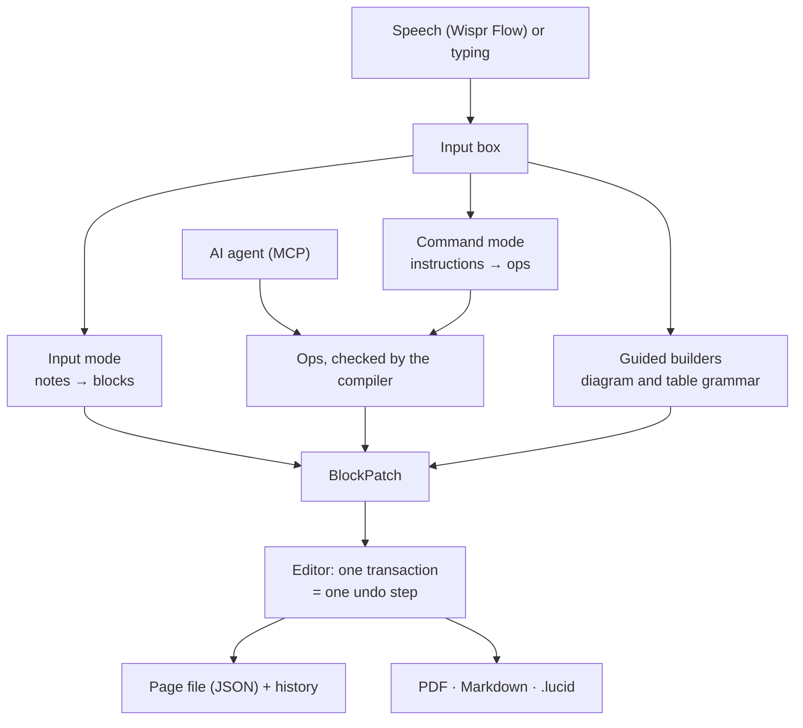

# How Lucid fits together

Lucid keeps one idea throughout: **a page is a list of typed blocks, and every change to it is a patch.** The model, the
guided builders and AI agents all produce the same kind of patch, so each change can be checked, shown, undone and reverted in
the same way.

## Packages

| Package | Role |
|---|---|
| `packages/core` | Pure TypeScript, no DOM, no network. The document model (`model/`), the op language and its checks (`ops/`), the diagram language LGN and its Mermaid output (`lgn/`, `mermaid/`), the guided builders' grammar (`guided/`), grounding checks (`grounding/`), reverts, and the saved file format (`persistence/`). |
| `packages/kit` | The block kit. Each block type is a folder with its schema, a short description for the model, outline, Markdown and LaTeX output and fixtures. Also the note formats (`formats/`), the Lucid Markdown language the model writes (`lmd/`), the op compiler (`ops/`) and the LaTeX document builder (`latex/`). |
| `packages/llm` | The LM Studio client (streamed `/v1/chat/completions`, reasoning off), the Input and Command pipelines, and the prompts. |
| `packages/mcp` | The MCP server and the socket protocol between it and the running app. |
| `packages/evals` | Eval cases and the runner that scores the model against them. |
| `packages/mock-lmstudio` | A scripted LM Studio for tests. |
| `apps/desktop` | The Electron app. `electron/` is the main process (library files, settings, LM Studio status, the PDF pipeline, the menu, the agent bridge); `src/` is the React renderer (the BlockNote editor and its adapter, the input box, the job queue, the builders, the preview). |

## The page and its changes

- A **block** has an id, a type, props, inline content and a status (normal, crossed out, chosen). Tables and diagrams carry
  stable ids inside (`r2`, `c1`, node and edge ids), so an edit names exactly the part it changes.
- A **BlockPatch** is plain data: insert, update or remove blocks. The editor applies one in a single transaction, which is
  what makes every AI change exactly one undo step. The same patches are stored as the change history, and **Revert** replays
  the inverse of one earlier change on the blocks it touched, if they are still as that change left them.
- A page is saved as one JSON file (validated with Zod, versioned and migrated). The `.lucid` export is the same file; its
  importer checks every block and never overwrites.

## From words to blocks

- **Input mode:** the model is given the page outline, the note format's section hints and your words, and writes Lucid
  Markdown. The kit parses it into blocks; a grounding check compares them with what you said (words, and numbers you never
  said); at most one repair round follows. If nothing usable comes out, your words are kept as an *unprocessed* paragraph.
- **Command mode:** the model writes ops in a small JSON language that refers to blocks by number (`b3`, `b3.2`, rows `r2`,
  columns `c1`). The compiler applies them to a copy of the page. The result is an edit, a proposal (it would throw something
  away, so it waits for a yes), a question (it is unsure which thing you meant) or "nothing to do".
- **Guided builders:** a grammar in `packages/core/src/guided` reads "client to server", "rename 3 to Cache" and similar, and
  builds diagrams and tables step by step; only what the grammar cannot read goes to the model, with the builder's numbering.

## PDF

The renderer draws each diagram and chart as SVG with Mermaid. The main process converts the SVG to vector PDF with Electron's
own Chromium (`printToPDF` in a hidden window), then builds a LaTeX document from the blocks with the kit's house style
(`latex/lucidSty.ts`) and compiles it with the bundled Tectonic. The first run downloads Tectonic's typesetting files; the
converted figures are cached by content, and a newer request for the same page cancels one still running.

## Agents

`packages/mcp` is a stdio MCP server started by the agent. It talks to the running app over a socket in the library folder
(one JSON request per connection, readable only by the user). The app answers from the page that is open, so an agent's
edit is applied in the editor and listed in the history as the agent's, as one undo step. Edits carry the page's `revision`
and are refused if the page changed since the agent read it.

## Systems and packaging

Lucid is one Electron app for macOS, Windows and Linux. The few things that differ are small and take the system as an argument so
they can be tested everywhere: where Tectonic and LM Studio are found (`electron/tools.ts`, `electron/studio.ts`), the agent
connection (a socket file on macOS and Linux, a named pipe on Windows: `packages/mcp/src/socket.ts`) and the menu (About is in the
Lucid menu on a Mac and in Help elsewhere). `pnpm dist` builds the packages of the system it runs on (`electron-builder.yml`); the
PDF engine for that system is fetched with a pinned checksum by `scripts/fetch-tectonic.mjs` and put in the app's resources, and the
`afterPack` hook refuses an app that lacks a file it must carry. The release workflow builds on a runner of each system and tests
the unpacked app and then what a person installs, before one job publishes everything with `SHA256SUMS`.

## Tests

| Level | Command | Notes |
|---|---|---|
| Unit | `pnpm test` | all packages; includes property tests and golden files |
| End to end | `pnpm e2e` | Electron with the scripted LM Studio, in a maximized window |
| Packaged app | `pnpm dist:dir && pnpm e2e:packaged` | the built app with nothing else on the `PATH`; on macOS, Windows and Linux |
| Real model | `pnpm eval`, `pnpm e2e:real` | needs LM Studio and `qwen/qwen3.8-27b` |
