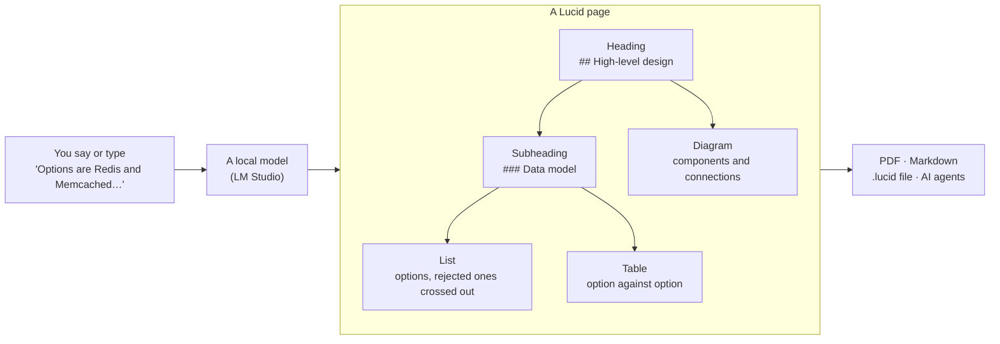

# What Lucid does

Engineers think in structure. A system design is an outline of sections and sub-sections, a list of options with the rejected
ones crossed out, a table that compares them and a diagram of how the parts connect. Lucid builds exactly that document while
you think out loud, so you never stop to format.

## Typed blocks

Everything on a page is a **typed block**. The model only chooses which block fits what you said and fills it in; Lucid draws
and typesets it, so the result looks the same every time.

| Block | What it holds | How it is drawn |
|---|---|---|
| **Heading, subheading** | the outline: title, sections, sub-sections | numbered sections in the PDF |
| **List** | options, steps, trade-offs; bullets, numbered steps and checklists, each item on its own so one can be crossed out | bullets, struck-through when rejected |
| **Table** | a comparison: properties by options | a typeset table |
| **Diagram** | how parts connect: architecture, request flow, sequence, entities | drawn from components and connections, a database as a cylinder, a queue as a pipe |
| **Callout** | the key takeaway, a decision, a trade-off, a warning, an open question | a highlighted box |
| **Formula** | back-of-the-envelope maths (KV-cache size, FLOPs, bandwidth) | typeset LaTeX maths |
| **Chart** | numbers you dictated: bars or lines | a labelled chart |
| **Code** | an API request, a query, a shell command | a code listing |

What stays true whatever you say:

- **The model never writes LaTeX or drawing code.** It fills blocks; a fixed house style does the typography.
- **You stay in charge.** Every change by the model is exactly one undo step, any earlier change can be reverted on its own, and
  your words are never lost: if the model cannot use them, they are kept as written.
- **One view.** The page, one input box under it, an optional history panel. It scales to a full-screen window.

## Three modes, one box

| Mode | Your words are | Switch |
|---|---|---|
| **Input** | notes, written into the page and structured | ⌘1 |
| **Command** | instructions about the page: "add a CDN in front of the web server", "undo" | ⌘2, or hold the right ⌥ key for one command |
| **Edit** | typing in the page itself | ⌘3 |

⌘4 opens the diagram builder and ⌘5 the table builder. Each mode can also be chosen by voice ("command mode"). Changes that
would throw something away wait for a yes; when Lucid is unsure which thing you mean, it asks.

## Diagrams and tables by voice

A diagram of ten parts is hard to say in one breath, so there is a guided builder: say the **components**, then the
**connections** ("client to server"), then fix them **by number** ("rename 3 to Cache", "reverse 2"). A database is drawn as a
cylinder, a queue as a pipe, a CDN as a cloud, a load balancer as a hexagon. Big diagrams stay readable in the page and in the
PDF. Tables have a builder in the same spirit.

## Say which block you mean

Every block has a light number in the margin (B1, B2, …). Click one to see its parts, then say *"in block 3, add a row for
cost"* or *"cross out item 2 of block 6"*. The numbers can be hidden in Settings.

## History you can trust

The panel on the right lists what you said and every change to the page: by Lucid, by a builder, by an AI agent, or a revert.
**Show** scrolls to what a change touched. **Revert** takes back *one earlier* change, not just the last, and leaves later
changes to other blocks alone.

## Export, and how the PDF looks

- **PDF**, typeset with Tectonic in a fixed house style (numbered sections, real tables and figures, formulas). Settings →
  **PDF look** changes the paper (A4 or Letter), the text size, the typeface, the margins, an accent colour, whether headings
  are numbered and whether the date shows. **Edit template…** opens `lucid.sty`, the file behind the house style, to change
  anything else; if it has a mistake, the PDF is made with the built-in one and says so.
- **Markdown** (diagrams as Mermaid blocks).
- **A `.lucid` file**, the whole note with its history, to back up, move to another computer or share.

Light and dark themes, three typefaces for the page on screen, and a zoom for the page (⌘+, ⌘−, ⌘0) are in the app. Pages are
plain files in `~/Lucid` (one JSON file per page).

## Note formats

A **note format** is the skeleton of a page. See [formats](formats.md).

## Agents, dictation, accessibility

- [Dictation](dictation.md): which apps to speak with, and a ten-minute check-list.
- [Accessibility](accessibility.md): why Lucid exists, and how to use it by voice or with one hand.
- [For AI agents](mcp.md): Lucid is an MCP server.
