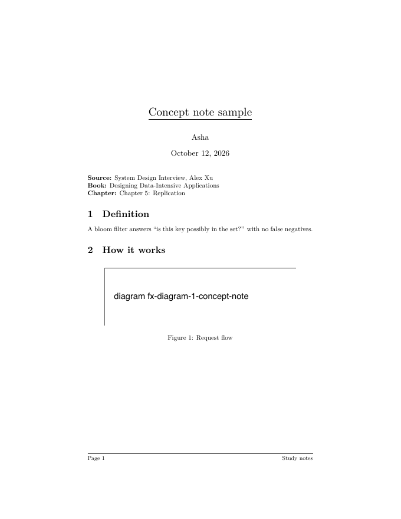
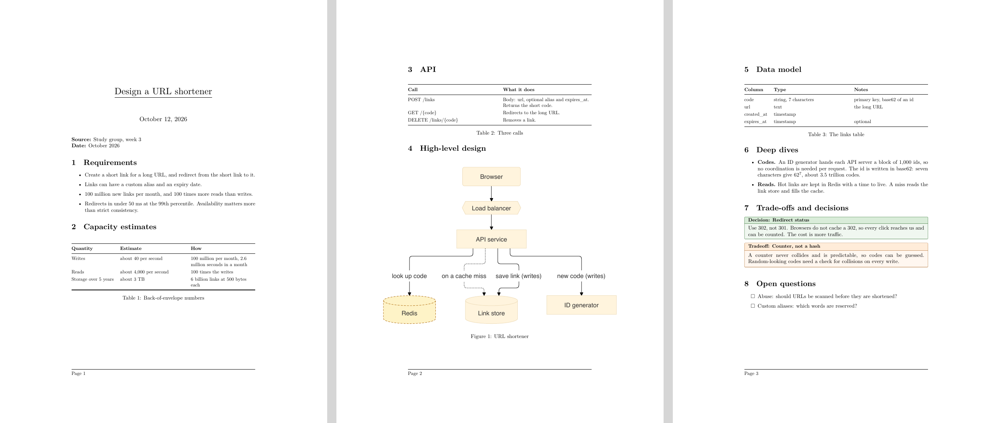
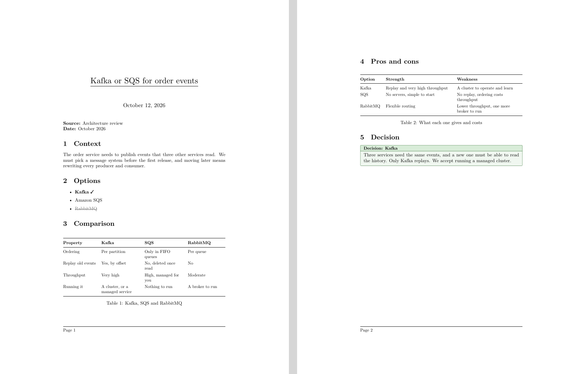

# Note formats

A **note format** is the skeleton of a page: its sections, a hint for each saying what belongs there, and which blocks suit it.
Start a page from one with **New from a format…**; Lucid suggests one from what you say, and you always choose. Or take the **Blank page** and write what you like: the formats are general on purpose (a concept, a design, a comparison), not one for every subject. A page of a
format starts as its section headings, and what you dictate goes under the right one. Sections left empty are not printed.

| Format | For | Sections |
|---|---|---|
| **Concept note** | one computer-science or system-design idea | Definition · Intuition · How it works · Example · Pitfalls and gotchas · Related concepts |
| **System design** | designing a system end to end | Requirements · Capacity estimates · API · High-level design · Data model · Deep dives · Trade-offs and decisions · Open questions |
| **Comparison** | choosing between technologies | Context · Options · Comparison · Pros and cons · Decision |

## What the PDFs look like

Each picture is the PDF of a sample note, made with the real app ([how](format-samples/README.md); the numbers in them are made up).

**Concept note**

**System design**

**Comparison**

## Open to other fields

The formats lean towards engineering because that is what Lucid was made for, but nothing else in Lucid does. A format is a
small data entry in [`packages/kit/src/formats/index.ts`](../packages/kit/src/formats/index.ts): an id, a description, keywords
for the suggestion, the sections and the blocks that suit them. A lab notebook, a reading log or a study plan is one more
entry. New block types (one folder each) work the same way. See [CONTRIBUTING.md](../CONTRIBUTING.md#adding-a-note-format).
