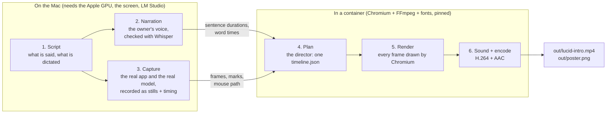

# The Lucid intro video, made as code

This folder makes the Lucid introduction video **by running programs, not by editing a timeline by hand**. Nobody opens a
video editor: the script, the screen recording, the narration, the animation and the final encode are all steps you can run
again. If Lucid changes (a new button, a cleaner title bar), you rebuild the app, run the pipeline, and the video is made
again with the new look.

This kind of video is called a **product demo** or **launch video**. Making one from code is called **programmatic video**
("video as code"). It is how tools such as Remotion, Motion Canvas and Revideo work: a video is not a file you edit but a
*function of time*, "what does frame 1234 look like?", written as a program and rendered frame by frame.

> **Everything on screen is real.** The window is the real Lucid app, driven by a program, running against the real
> `qwen/qwen3.8-27b` model in LM Studio on the Mac. The PDF is typeset by the real app. The agent part is a real MCP client
> calling the real tools. The voice is the owner's own voice, cloned with the owner's permission. What the video adds is
> presentation: the background, the camera moves, the rings, the captions, the sound effects, and cuts that shorten how long
> the model took (each cut is labelled "shortened" on the screen). See [What is real, what is presentation](#what-is-real-what-is-presentation).

The result is a 1920 × 1080, 30 fps H.264 + AAC video of about 90 seconds (`out/lucid-intro.mp4`) and a 1280 × 640 poster
(`out/poster.png`, usable as the GitHub social preview). Neither is committed.

## The pipeline, in plain words



The order matters: **audio first**. The voice is made before anything else, and how long each sentence really is decides how
long each scene is. The picture is then fitted to the words, never the other way round.

### 1. Script (`script/`)

Two small data files, no code:

| File | What is in it |
|---|---|
| `script/narration.json` | The narration, sentence by sentence, grouped into scenes with a chapter title. A sentence may carry a `say` spelling for the voice ("Whisper Flow") while the caption keeps the real name ("Wispr Flow"). |
| `script/dictation.json` | What is dictated into Lucid during the capture (the notes about a URL shortener, the command "Add a cache in front of the database."), the page used for the format dialog, and what the agent adds. |

The subject is a URL shortener on purpose: it is easy to check. Base 62 with 7 characters is about 3.5 trillion codes, a
counter is easy to guess and never collides, a random code or a hash needs a collision check, and a cache sits between the
app servers and the database.

### 2. Narration (`narration/narrate.mjs`), on the host

The owner's project **VENT** has a local voice server (`voice/`) that speaks in the owner's own voice, with zero-shot voice
cloning (Chatterbox-Turbo through `mlx-audio`, on the Apple GPU). The script sends it one sentence at a time, then:

1. **measures** the real length of each sentence with `ffprobe` (this becomes the contract for the timeline);
2. **listens to it again** with a local Whisper (`mlx-whisper`, `whisper-large-v3-turbo`) and compares what was heard with
   what was meant. A sentence that is garbled ("Ducid" for "Lucid", "blooped" for "broke") is thrown away and spoken again, up
   to six times; the word "Lucid" must always be heard as written;
3. keeps **word times** from Whisper, aligned letter by letter with the caption words (so "Whisperflow" lines up with "Wispr
   Flow"), which later drive the on-screen captions and pin every visual beat to its word ("heading", "table", "cache").

Each sentence is trimmed of silence and brought to the same loudness (48 kHz mono). If the voice clone is not loaded on the
server, the script falls back to the server's default Kokoro voice and says so in `.cache/narration/manifest.json`.

The voice files stay in `.cache/` (git-ignored). Never commit them.

### 3. Capture (`capture/capture.mjs`), on the host

A Playwright script launches the **built Lucid app** (`apps/desktop/out`, from `pnpm build`) with a throw-away library
(`LUCID_HOME` in a temp folder, so no real notes are involved), sizes the window to 1600 × 900 CSS pixels at 2x, and uses
it the way a person does:

- clicks **New page** with a real mouse move, types the title;
- delivers the dictated words the way a dictation app does: a paste. They land in the box at once and Lucid sends them by
  itself after a short pause. A synthetic paste event is used so that the owner's clipboard is never touched;
- waits for the **real model** to answer, then checks that the take tells the story (a heading, a list, a filled table, a
  diagram, a cache between the app servers and the database, no "some details may not match" warning). The model is not
  deterministic, so a take that misses is thrown away and redone (`ATTEMPTS`, default 3);
- clicks **Download PDF** (the save dialog is answered with a temp file) and turns the first page into an image;
- opens **New from a format…**, says what the page is about, and lets the model suggest a format;
- goes back to the first page and connects a real MCP client to the app's bundled MCP server: `list_documents`,
  `get_outline`, `insert_notes`.

While it works, a recorder photographs the window about 24 times a second (3200 × 1800 JPEGs; identical frames are dropped)
and writes down **marks** (named moments, with the on-screen rectangles of the heading, the table, the diagram nodes and
more) and the **mouse path**. The result is `.cache/capture/`: `frames/`, `manifest.json`, the PDF page images. It also
records whether the window has a system title bar (`titleBar`) or draws under it (then where the traffic lights go): the
composition draws the window frame accordingly.

### 4. Plan (`render/plan.mjs`), the director

This is where the video is *composed*. The planner reads the narration and the capture and writes **`timeline.json`**: one
file with everything the renderer needs, as data:

- the **source map**: for every moment of the video, which moment of the capture is shown (real time, held, or a cut with a
  dissolve), so that a recording of nearly two minutes tells its story in a minute and a half;
- the **camera**: zoom and pan keyframes towards what is being talked about;
- **rings and labels** around the real on-screen rectangles (the heading, the list, the table, the cache node, the Undo link),
  each appearing on the word that names it;
- **captions** with word times, chapter labels, the title cards, the terminal for the MCP part, the PDF page and the "plain
  data" card (a real excerpt of `packages/kit/src/formats/index.ts`);
- the **sound cues** (which sound, when) and the narration placement.

`node render/report.mjs` prints the timeline in words (every scene, sentence, ring and cut, with the word being said), so it
can be reviewed without watching the video.

### 5. Render (`render/render.mjs` + `render/stage/`), in the container

The **stage** is one web page, 1920 × 1080, that draws the whole video as a pure function of time: `stage.seek(t)` sets every
element for time *t* (no CSS animations, no clocks). Chromium draws it, and the renderer takes a screenshot for every frame
(30 per second, three pages at a time) and pipes them into FFmpeg. Because nothing depends on the real clock, the same inputs
give the same video: two renders in the container give byte-identical frames.

The look: a soft, slowly moving gradient behind a floating window (rounded corners, soft shadow), iA Writer Mono (the app's own
typeface) everywhere, the app's black and white with a few calm accent colours, a camera that eases towards what is being
talked about, rings that appear on the word that names them, and word-by-word captions.

### 6. Sound and encode (`render/sfx.mjs`, `render/mix.mjs`)

All sound except the voice is **made from nothing** in code: clicks, key ticks, pops, whooshes and chimes are synthesised from
noise and sine waves with a seeded random generator, plus a very quiet ambient pad that ducks under the voice. No sample
library, no licence to check. `mix.mjs` places the narration and the cues at the times of the timeline; FFmpeg normalises the
loudness (about −16 LUFS, true peak −1.5 dBFS) and muxes **H.264 (High, yuv420p, BT.709) + AAC** into `out/lucid-intro.mp4`.

The same stage renders the **poster** (`--poster`): the title, one line about what Lucid does and a real frame of the app.

## Why a container, and what cannot be in it

| Stage | Where | Why |
|---|---|---|
| LM Studio + the model | host | needs the Apple GPU (Metal); a Linux container on a Mac cannot use it |
| Voice server (Chatterbox, Kokoro) and Whisper on MLX | host | MLX runs on the Apple GPU only |
| Capture (the Electron app) | host | a macOS app, with a real window, and the real model behind it |
| **Plan, render, encode** | **container** | pure computation from files: Chromium + FFmpeg + fonts, all pinned |

The container makes the *last* part, the one that turns inputs into pixels, **repeatable**: the same Chromium build, the same
FFmpeg, the same font files, the same flags, on any machine. The inputs (captured frames, narration) are **mounted** into it,
never baked into the image, so the owner's voice never ends up in an image layer. The image is
[`mcr.microsoft.com/playwright:v1.64.0-noble`](https://mcr.microsoft.com/en-us/artifact/mar/playwright) (Ubuntu 24.04, Node 24,
the Chromium that Playwright 1.64.0 expects), pinned by digest in the `Dockerfile`, plus Ubuntu's `ffmpeg` 6.1.1 (x264, AAC)
and the font from `package-lock.json`.

Without Docker the render stage runs on the Mac too (`make render-host`). A render on the host and one in the container
differ only by anti-aliasing (a PSNR of about 43 dB between two frames); the container is the reference.

## Run it

```bash
# Once
pnpm install && pnpm build                 # at the repository root: the app that is recorded
cd video && npm ci                         # Playwright, the font, the MCP client

# Needed while narrating and capturing
#   the VENT voice server:  ./voice/start.sh --bg   (in the VENT folder; it listens on http://127.0.0.1:8880)
#   LM Studio, with qwen/qwen3.8-27b loaded and its server on (`lms ps`)

make narrate     # the voice, listened to again with Whisper      -> .cache/narration
make capture     # the real app, the real model (about 2 minutes; keep your hands off the keyboard)
                 #                                                 -> .cache/capture
make render      # plan + render + encode, in the container       -> out/lucid-intro.mp4, out/poster.png
```

Handy:

| Command | What it does |
|---|---|
| `node narration/narrate.mjs --only hook-1` | speak one sentence again |
| `node narration/narrate.mjs --retime` | recompute the word times of the captions without the voice server |
| `node render/plan.mjs && node render/report.mjs` | rebuild the timeline and print it in words |
| `node render/render.mjs --stills 12.5,40 out/s` | a few single frames, to look at |
| `node render/render.mjs --from 20 --to 30` | one part (no sound) |
| `node render/verify.mjs` | listen to the finished file with Whisper and compare when every sentence is heard with the timeline; print the codecs |
| `node capture/lib/peek.mjs d4.done+400 a.jpg` | copy the captured frame nearest to a mark, to look at |
| `docker compose run --rm render sh -c "node render/plan.mjs && node render/render.mjs --poster"` | the poster only |

Settings through environment variables: `VENT_TTS_URL` (voice server), `WHISPER_MODEL`, `MLX_WHISPER`, `ATTEMPTS` (capture),
`RENDER_WORKERS` (pages rendering at once, default 3), `CHROMIUM_PATH` (use another Chromium on the host).

**When Lucid's look changes:** `pnpm build`, `make capture`, `make render`. The planner finds everything by the marks the
capture wrote, so a new title bar, a moved button or a new colour needs no change here. A renamed CSS class in the app
(`.dictation`, `.lm-pill`, `.np-format`, `aside.side`...) does: those selectors are in `capture/lib/app.mjs` and
`capture/capture.mjs`.

## Tools used, tools considered, and licences

| Tool | Role here | Licence | Notes |
|---|---|---|---|
| **Playwright** (`playwright`) | drives the Electron app in the capture; runs Chromium for the stage | Apache-2.0 | |
| **Chromium** | draws every frame | BSD-3-Clause and others | the one in the Playwright image |
| **FFmpeg** | encodes H.264 + AAC, measures and trims the voice | LGPL-2.1+ (GPL-2+ with x264) | used as a separate program, not linked |
| **mlx-whisper** and Whisper large-v3-turbo | checks the narration, gives word times | MIT, MIT | on the Mac GPU |
| **VENT voice server**: Chatterbox-Turbo (Resemble AI) via **mlx-audio**; Kokoro-82M | the owner's cloned voice (fallback: Kokoro) | MIT, MIT, Apache-2.0 | the clone's reference recording is the owner's and private |
| **iA Writer Mono** (`@fontsource/ia-writer-mono`) | all type | SIL OFL 1.1 | the app's own typeface |
| **MCP TypeScript SDK** | the MCP client in the capture | MIT | host only |
| **Remotion** | *considered* | source-available, **not** open source: free for individuals, non-profits and for-profit companies of up to 3 employees; a company licence is needed above that | not used |
| **Motion Canvas** | *considered* | MIT | great for animated explainers; its editor and generator-based scenes are more than recording a real app needs |
| **Revideo** | *considered* | MIT | headless rendering API with audio (a Motion Canvas fork); a good fit, but a larger dependency than this video needs |
| **Editly**, **MoviePy** | *considered* | MIT | video editing driven by data or Python on top of FFmpeg; no good way to move a camera over a web page |
| **Playwright `recordVideo`** | *considered* | Apache-2.0 | records low-quality VP8; stills at 2x look much better |
| **whisper.cpp**, **faster-whisper**, **WhisperX** | *considered* | MIT, MIT, BSD-2-Clause | any would do; `mlx-whisper` was already on the machine |
| **Piper**, **Coqui XTTS** | *considered* for the voice | MIT (the archived original); a non-commercial licence | not used: the owner's own cloned voice was the point |

**Why not Remotion?** It is the best-known tool and works the same way as the stage here (React components drawn by headless
Chromium, frames piped to FFmpeg). But its licence is not an open-source one: a company of more than three people must buy a
licence, and Lucid is an MIT project that anyone may fork and run. The stage here is about 700 lines of plain JavaScript and
500 of CSS, with no dependency beyond the browser, does the same job for this video, and everything around it is MIT or
Apache-2.0. If you prefer an existing tool with an MIT licence, Revideo or Motion Canvas are the nearest.

## What is real, what is presentation

| On screen | Is it real? |
|---|---|
| The window, the notes, the table, the diagram, the history panel, the Undo link | Real frames of the real app, captured as they happened |
| The model's answers | Real `qwen/qwen3.8-27b` output through LM Studio; the capture is repeated until the answer tells the story |
| Waiting for the model (5 to 15 seconds a time) | Shown in real time when it fits; otherwise cut with a dissolve and labelled "Model time: N s, shortened" |
| Text landing in the input box | The app's real paste path (a synthetic paste event); the moment is held for about a second so it can be read |
| The PDF page | The first page of a PDF the app really typeset (Tectonic), turned into an image |
| The format dialog | The real dialog and the real model's suggestion |
| The terminal | The real calls and replies of a real MCP client (a short script, not Claude Code), shortened to fit the lines |
| The format excerpt | Real lines of `packages/kit/src/formats/index.ts`; the "lab-notebook" line is the made-up example of "one more entry" |
| Rings, labels, captions, camera, background, sounds, the waveform on the first card | Added by the composition (the waveform follows the real narration) |
| Wispr Flow, OpenWhispr, VoiceNative | Names of dictation tools that can paste text into Lucid; Lucid does no speech recognition itself |
| "I broke my right hand" | The owner's own story, as given for this video; confirm the wording before publishing |

## Files

```
video/
  script/          narration.json, dictation.json        what is said and what is dictated
  narration/       narrate.mjs, lib/text.mjs             voice + Whisper check, word times (host)
  capture/         capture.mjs, lib/                     the real app, recorded (host)
  render/          plan.mjs                              narration + capture -> timeline.json
                   stage/ (stage.html, .css, .js)        the page that is a function of time
                   render.mjs, mix.mjs, sfx.mjs          frames, sound, encode
                   report.mjs, verify.mjs                the timeline in words; the finished file, checked
  Dockerfile, compose.yaml, Makefile
  .cache/          (git-ignored) voice audio, captured frames, timeline, sound mix
  out/             (git-ignored) lucid-intro.mp4, poster.png
```

## Limits to know

- The model is not deterministic: every capture is a new take. The capture only keeps a take whose notes tell the story, but
  its words (and so the video) differ a little from one run to the next.
- The first PDF needs Tectonic's typesetting files (the app downloads them once). The capture assumes they are there.
- Whisper times a sentence's first word a little early when it listens to the whole video; `verify.mjs` therefore reports
  starts and ends, and the ends are the reliable ones (within about 0.15 s).
